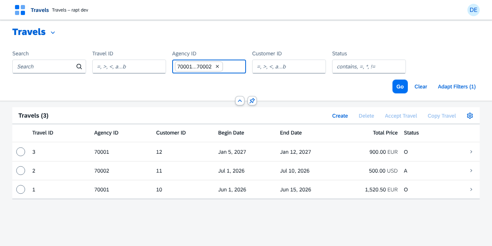
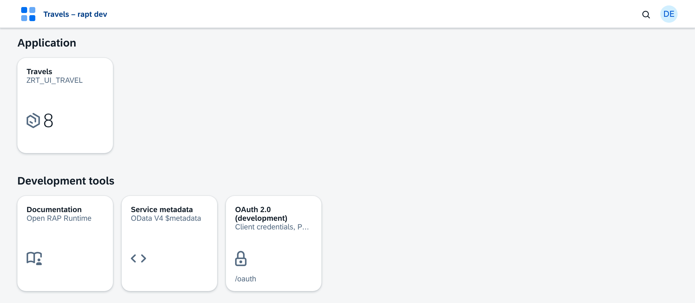
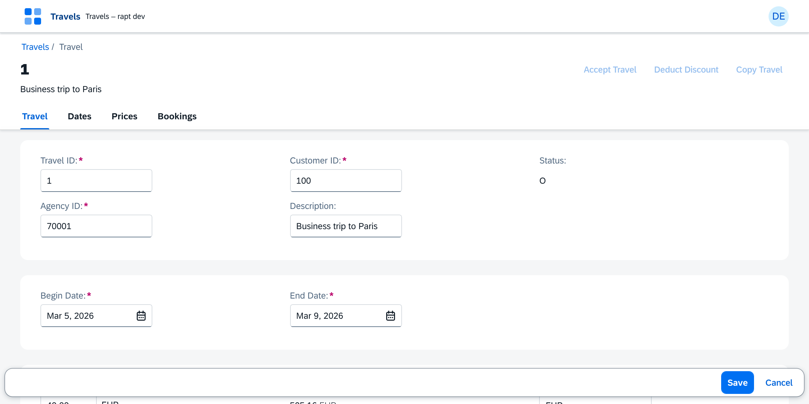

# rap-transpiler

**Develop, test and deploy your RAP business objects without an SAP system.**

You write your RAP BO as in the ABAP Development Tools — tables, CDS views, UI annotations,
behavior definition, behavior pool in ABAP, service — and rap-transpiler turns it into an
application that runs anywhere: an OData V4 service, the RAP managed runtime with your ABAP code,
a PostgreSQL database and a List Report / Object Page UI in OpenUI5. The same sources are then
imported into SAP with abapGit.



## What it is for

- **Learning and teaching RAP** without a license or a system: the complete cycle BDEF → behavior
  pool → OData → Fiori, locally, in a few seconds.
- **Prototyping** a BO and showing it to a customer or a business team before opening a system.
- **Testing** the logic of a BO (determinations, validations, actions, authorizations) in CI.
- **Shipping a small standalone application** (Docker, SAP BTP Cloud Foundry, an internal server)
  when an SAP system is not justified.
- **Opening the BO to AI agents**: the service becomes an MCP server whose tools all apply the
  checks of the BO.

Everything is open source under permissive licenses: no CAP, no SAPUI5, no proprietary SAP
library ([LICENSES.md](LICENSES.md)).

## Get started in two minutes

**In VS Code**: install the `rap-transpiler-vscode.vsix` extension (it contains everything), then
run *RAP: New business object* and *RAP: Start rapt dev*. The browser opens on the development
launchpad.

**On the command line** (Node.js 22, from a clone: `pnpm install && pnpm build`, then
`node packages/compiler/dist/cli.js` instead of `rapt`):

```sh
rapt new my-project Travel --prefix ZRT    # a complete managed BO, with data
rapt dev my-project                         # http://localhost:8080/ — rebuilt on each save
```



## What you get

| You write (abapGit format) | rap-transpiler produces |
|---|---|
| Tables (`define table`, as in ADT), CDS table entities | PostgreSQL tables, initial data |
| CDS views, projections, CDS types (simple, enumerated), DCL | SQL views, OData V4 `$metadata`, per-user access controls |
| Metadata extensions (`@UI`) | List Report, Worklist, Analytical List Page, Overview Page (Fiori filters, user views, value helps, charts) and Object Page |
| Behavior definition | RAP managed runtime: draft, locks, ETags, numbering, authorizations, feature control, determinations, validations, actions |
| Behavior pool (ABAP Cloud) | The same code, transpiled and run: EML, messages, ABAP SQL, released classes (JSON, HTTP, bgPF, e-mail…) |
| Service definition | OData V4 service at the SAP paths, `$batch`, CSRF, OIDC |
| `rapt/mcp.json` | MCP server for AI agents |
| `launchpad.json` | OpenUI5 launchpad: spaces, pages, tiles by role, single sign-on |



## Key features

- **Write only ABAP**: `rapt new` (a complete BO), `rapt generate` (a table, a view from its
  table, a projection, a BDEF with its compositions, a behavior pool…), `rapt abapgit` (the XML
  files for the import into SAP).
- **Development loop** `rapt dev`: embedded database, rebuild on each save, positioned
  diagnostics (`file:line:column`), development launchpad with the built-in documentation.
- **Modes**: `standard` (strictly as on SAP, activatable on SAP) or `enhanced` (extensions:
  mandatory fields checked automatically, managed BO on a custom entity, CDS enumerated types
  exposed as OData `EnumType`).
- **Draft** (`with draft`, `with collaborative draft`): drafts, Edit / Activate / Discard,
  exclusive lock, editing status, invited users, as in Fiori Elements.
- **Table entities and CDS types**: a complete BO on a `define table entity`, simple and
  enumerated types.
- **Standard views** `I_Currency`, `I_UnitOfMeasure`, `I_Country`, `I_Language`, `I_Region`,
  `I_CalendarDate`, `I_TimeZone`, `I_BusinessUserBasic`, `I_ExchangeRate` with their data, for
  your value helps.
- **Fiori UI**: List Report, Worklist, Analytical List Page (`$apply`), Overview Page, Form entry;
  filters with conditions (`>100`, `1...5`, `*abc*`), views saved per user, table settings, value
  helps, actions, editable compositions.
- **Security**: OIDC (Keycloak, SAP Cloud Identity Services, Entra ID…), Web API bindings with
  OAuth 2.0 (client credentials, PKCE), authorization objects and `AUTHORITY-CHECK`, DCL, roles.
- **Deployment**: Docker, `docker compose`, SAP BTP Cloud Foundry (`cf push`), any Node.js
  server.
- **VS Code extension**: object creation wizard as in ADT, *RAP Objects* view, floorplan choice,
  every command of the CLI, diagnostics in the Problems tab, ABAP, CDS and BDEF highlighting.

## Documentation

| Document | Content |
|---|---|
| [Guide](docs/GUIDE.md) | Everything rap-transpiler does and how to use it (humans and AI agents) |
| [Features](docs/FEATURES.md) | RAP coverage, feature by feature |
| [Annotations](docs/ANNOTATIONS.md) | Each CDS annotation: what the `$metadata` and the UI do with it |
| [Diagnostics](docs/DIAGNOSTICS.md) | The codes of `rapt check` |
| [MCP server](docs/MCP.md) | The service for AI agents |
| [Deployment](docs/DEPLOYMENT.md) | Docker, SAP BTP Cloud Foundry, HTTPS |
| [Utility classes](docs/UTILITIES.md), [Remote APIs](docs/REMOTE_APIS.md) | The behavior pool beyond RAP |
| [Known gaps](KNOWN_GAPS.md), [Roadmap](docs/ROADMAP.md) | What is missing, what is coming |
| [Decisions](docs/DECISIONS.md), [Plan](PLAN.md) | The technical choices and their reasons |

The same documentation opens from the launchpad of `rapt dev` (*Documentation* tile), and on the
project website.

The project website (`site/`, published on GitHub Pages by the `site.yml` workflow) presents
rap-transpiler, contains this documentation and serves the `.vsix` of the latest version.

## Contributing

```sh
pnpm install
pnpm build
pnpm test                    # vitest: compiler, runtime, browser (Playwright if present)
```

```
packages/model/      types of the IR (model.json), shared naming conventions
packages/compiler/   rapt CLI, parsers (BDEF, CDS, SRVD, DCL), IR, generators
packages/runtime/    runtime of the generated applications (OData V4, RAP managed, launchpad, MCP)
packages/vscode/     VS Code extension (calls the rapt CLI)
fixtures/            reference BOs: travel (Travel / Booking), custom-entity, table-entity
site/                project website
```

The rules for working on the repository (for humans and agents alike) are in
[AGENTS.md](AGENTS.md).

## License

MIT ([LICENSE](LICENSE)); dependencies under permissive licenses ([LICENSES.md](LICENSES.md)).
